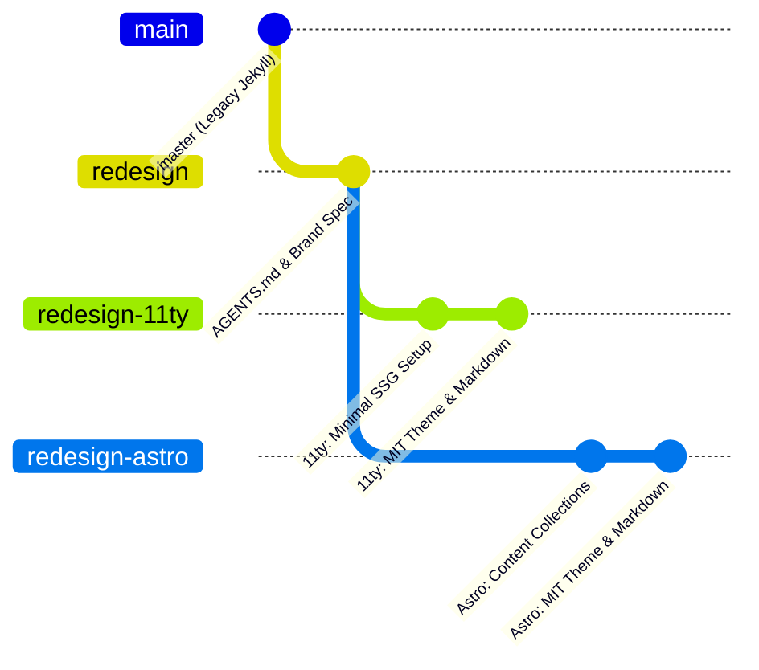

# AGENTS.md — Contributor & AI Agent Specification

> **Project**: Personal Website & Algorithmic Arts Portfolio (`khoparzi.com` / `khoparzi.github.io`)  
> **Author**: Abhinay Khoparzi (Creative Technologist, Algorave Artist, Livecoder, Video Producer)  
> **Base Branch**: `redesign`  
> **Target Implementations**: `redesign-11ty` (Eleventy) & `redesign-astro` (Astro)  
> **Design Reference**: [MIT Brand Guidelines](https://brand.mit.edu)  
> **Status**: Draft Proposal — Pending User Approval (Do NOT commit without approval)

---

## 1. Project Mission & Redesign Goals

This project undertakes a complete rewrite and redesign of Abhinay Khoparzi's personal website. The existing site runs on legacy Jekyll with legacy dependencies (Bootstrap, jQuery, etc.). 

The redesign has the following primary objectives:
1. **Brand Alignment**: Adopt the modernist, rational, high-contrast visual design principles defined in the [MIT Brand Guidelines](https://brand.mit.edu).
2. **Zero Google / Adobe Fonts**: Strictly eliminate all external font CDN calls (Google Fonts, Adobe Typekit/Fonts, Bunny Fonts). Rely exclusively on clean, accessible system neo-grotesque font stacks and system monospace stacks.
3. **Dependency Minimalism**: Keep tooling and runtime dependencies lean and lightweight. No heavy client-side frameworks, bulky CSS frameworks, or bloated utility libraries.
4. **Markdown-First Content**: Maintain Markdown as the single source of truth for authoring blog posts, documentation, notes, and portfolio entries.
5. **Vanilla JavaScript Everywhere**: Client-side functionality (theme switching, navigation, filtering) must use standard Vanilla JavaScript (modern ES modules and Web APIs) with zero framework overhead.
6. **Isolated Creative Coding Libraries**: Specialized creative coding libraries (e.g., [Strudel](https://strudel.cc) for livecoded algorithmic music, [Hydra](https://hydra.ojack.xyz) for livecoded visual synthesis) are strictly imported on-demand for specific interactive pages/posts only, never in the global site bundle.
7. **Two-Branch Architecture Prototype**: Build and evaluate two parallel modern static site architectures branched from `redesign`:
   - `redesign-11ty`: Pure static HTML/JS generation with Eleventy.
   - `redesign-astro`: Island architecture and content collections with Astro.

---

## 2. Design System & MIT Brand Identity

The redesign is anchored in the MIT brand identity ([brand.mit.edu](https://brand.mit.edu)), prioritizing clarity, intellectual rigor, high contrast, crisp geometry, and accessible information architecture.

### 2.1 Color Palette & Design Tokens

```css
:root {
  /* Core MIT Brand Colors */
  --mit-red: #750014;           /* Primary brand red (Pantone 202 C / RGB: 117, 0, 20) */
  --mit-bright-red: #ff1423;    /* Accent red for active states, alerts, badges (RGB: 255, 20, 35) */
  --mit-silver-gray: #8b959e;   /* Secondary brand neutral (RGB: 139, 149, 158) */
  --mit-black: #000000;         /* Primary text / deep contrast (RGB: 0, 0, 0) */
  --mit-white: #ffffff;         /* Background / pure canvas (RGB: 255, 255, 255) */

  /* Supporting & Contextual Tokens */
  --color-bg: var(--mit-white);
  --color-bg-subtle: #f6f7f8;
  --color-text: #1a1a1a;
  --color-text-muted: #555e65;
  --color-heading: var(--mit-black);
  --color-primary: var(--mit-red);
  --color-accent: var(--mit-bright-red);
  --color-border: #d8dde2;
  --color-border-strong: var(--mit-silver-gray);
  --color-code-bg: #f3f4f6;

  /* Extended Palette (used selectively for tags/categories) */
  --mit-dark-pink: #750062;
  --mit-cyan-accent: #007788;
  
  /* Layout & Geometry */
  --border-width: 1px;
  --max-content-width: 960px;
  --max-prose-width: 68ch;
  --radius-none: 0px;           /* Sharp, architectural edges matching MIT modernist aesthetic */
}

/* Dark Mode Theme Tokens */
@media (prefers-color-scheme: dark) {
  :root {
    --color-bg: #121416;
    --color-bg-subtle: #1c1f23;
    --color-text: #e2e5e8;
    --color-text-muted: #9aa2aa;
    --color-heading: #ffffff;
    --color-primary: #ff4d5a;   /* Accessible bright red for dark backgrounds */
    --color-accent: var(--mit-bright-red);
    --color-border: #2d3339;
    --color-border-strong: #4f5860;
    --color-code-bg: #1e2227;
  }
}
```

### 2.2 Typography System

> **MANDATE**: Do **NOT** use Google Fonts, Adobe Fonts, or any third-party font CDN. All fonts must be system-native fonts or self-hosted if absolutely required.

1. **Editorial & Body Typeface (Neo-Grotesque System Stack)**:
   - Reflects *Neue Haas Grotesk* (MIT's official typeface) and *Arial* (MIT's universal fallback) using modern system neo-grotesque fonts:
   ```css
   font-family: -apple-system, BlinkMacSystemFont, "Segoe UI", Roboto, "Helvetica Neue", Helvetica, Arial, sans-serif;
   ```
2. **Code & Monospace Stack**:
   - For livecoding snippets, Hydra code, Strudel patterns, configuration, and terminal output:
   ```css
   font-family: ui-monospace, SFMono-Regular, "SF Mono", Menlo, Monaco, Consolas, "Liberation Mono", "Courier New", monospace;
   ```
3. **Typographic Scale & Hierarchy**:
   - Base font size: `16px` / `1rem`, responsive scaling with `clamp()`.
   - Line height: `1.6` for prose body, `1.15` - `1.25` for headings.
   - Font weights: Regular (`400`), Medium (`500`), Bold (`700`).

### 2.3 Visual & Architectural Language
- **Grid Discipline**: Sharp 1px dividing rules (`border-bottom: 1px solid var(--color-border)`), architectural alignment, generous whitespace.
- **Micro-Interactions**: Crisp focus outlines (`2px solid var(--color-accent)`), minimal transitions (`150ms ease`), no sluggish animation libraries.
- **Accessibility**: Full WCAG 2.1 AA/AAA compliance with high contrast ratios for body copy, distinct interactive states, semantic HTML5 tags (`<main>`, `<nav>`, `<article>`, `<aside>`).

---

## 3. Technology Strategy & Engineering Guidelines

### 3.1 Dependency Minimization
- No client-side UI libraries (no React, Vue, Svelte, or solid-js runtime in client bundles).
- No heavy CSS frameworks (no Tailwind runtime, no Bootstrap, no Bulma). Pure CSS with modern features (CSS variables, CSS Grid, Flexbox, native nesting).
- Minimal npm dev dependencies strictly audited for build efficiency and security.

### 3.2 Markdown Authoring Workflow
- All existing and new posts live in Markdown format.
- Frontmatter follows a standardized schema:
  ```yaml
  ---
  title: "A Month of Marching: Raymarching in Shaders"
  date: 2021-03-30
  description: "Experiments and notes on distance functions and raymarching techniques."
  tags: ["shaders", "livecoding", "glsl", "art"]
  interactive: [] # optional: e.g. ["hydra"] or ["strudel"]
  toc: true
  draft: false
  ---
  ```
- Fast Markdown parser with code highlighting (using lightweight Prism CSS or low-overhead compile-time syntax highlighter; zero runtime client highlighter).

### 3.3 Vanilla JavaScript Rules
- Client JS is optional and progressive enhancement only.
- Written in vanilla ES6+ (native DOM methods, `addEventListener`, `fetch`, Custom Elements / Web Components if needed).
- Stored in clean, modular vanilla JS files (e.g., `theme-toggle.js`, `nav-toggle.js`).

### 3.4 Interactive Creative Coding Strategy (Strudel / Hydra)
Abhinay's work heavily features livecoding tools like Strudel (algorithmic music) and Hydra (video synthesizer).
- **Rule**: Never load Strudel or Hydra on global layouts or normal reading pages.
- **Implementation**:
  - Only load when explicitly requested by a post or page frontmatter (e.g., `interactive: ["strudel"]`).
  - Use dynamic module imports (`await import(...)`) or lazy load when the interactive canvas enters viewport (`IntersectionObserver`).
  - Provide a static placeholder / thumbnail / code block with an explicit "Initialize Live Audio / Canvas" button to respect browser audio policies and save battery/CPU.

---

## 4. Multi-Branch Strategy & Two-Approach Exploration



### 4.1 Branch Breakdown
1. **`master`**: Current live Jekyll site (preserved untouched).
2. **`redesign`**: Shared baseline branch:
   - Contains `AGENTS.md`, design documentation, core color tokens, migrated content files, and asset cleanups.
   - Master reference for both implementations.
3. **`redesign-11ty`** (Branched from `redesign`):
   - **Engine**: [Eleventy (11ty)](https://www.11ty.dev/) v3.x.
   - **Rationale**: Minimalist JavaScript SSG, zero client-side JavaScript sent to browser, fast local build times, direct HTML/Liquid/Nunjucks templating.
   - **Build Output**: Flat, pure static HTML/CSS/vanilla JS.
4. **`redesign-astro`** (Branched from `redesign`):
   - **Engine**: [Astro](https://astro.build/) v5.x (`output: 'static'`).
   - **Rationale**: Modern component architecture (`.astro`), strict schema validation for Markdown content collections via Zod, islands architecture for selective interactive widgets.
   - **Build Output**: Static HTML with zero client JS by default.

### 4.2 Evaluation & Comparison Matrix
Both approaches will be built to feature parity and compared on:
| Criteria | Eleventy (`redesign-11ty`) | Astro (`redesign-astro`) |
| :--- | :--- | :--- |
| **Build Speed** | Ultra-fast Node/V8 static pipeline | Fast Vite-based static pipeline |
| **Dependency Footprint** | Extremely minimal npm packages | Moderate npm packages |
| **Content Authoring DX** | Pure Markdown + template filters | Content Collections + Zod typing |
| **Interactive Islands** | Vanilla JS + custom elements | Native client:* directives or vanilla script |
| **Zero-JS Bundle** | 100% pure static HTML/CSS | 100% pure static HTML/CSS |
| **Maintenance Simplicity** | Very low maintenance overhead | Low-to-moderate maintenance overhead |

---

## 5. Content Inventory & Migration Map

The following existing pages and content must be preserved and rendered cleanly:

### 5.1 Posts (`_posts/` -> `content/posts/` or `src/content/posts/`)
- Total of 22+ posts covering:
  - Livecoding resources & setups (TidalCycles, Troop, SuperCollider, Arch Linux)
  - Creative coding challenges (30 Days of Code, Month of Julia, Month of Marching)
  - Hardware & Embedded systems (Raspberry Pi, Nvidia Jetson Nano, Kinect v1)
  - Algorithmic culture and talks (Pwn The Algorithm)

### 5.2 Standalone Pages & Sections
- **Home (`/`)**: High-impact bio, featured disciplines, recent works, latest writings, upcoming gigs.
- **About (`/aboutme`, `/bio`)**: Artist statement, biographical info, background, CV/Resume download.
- **Work Sections**:
  - **Feature Film (`/film`)**: Film projects (e.g. *Karan Gour*, *The Illusion of Reality*).
  - **Music & Algoraves (`/music`)**: Livecoding performances, releases, audio streams.
  - **Video Production (`/video`)**: Commercial, music video, and experimental video direction.
  - **Art & Exhibitions (`/art`, `/shader-art`)**: Generative and algorithmic artworks, shader experiments (Julia sets, raymarching).
- **Resources & Reference**:
  - **Hydra Reference (`/hydra-functions`)**: Documentation and function cheat-sheet.
  - **Livecode Resources (`/livecode-resources`)**: PDFs and cheatsheets for Hydra and TidalCycles.
- **Gigs & Events (`/gigs`)**: Chronological archive and upcoming performances.
- **Press (`/press`)**: Media coverage, interviews, articles.

---

## 6. Agent Operating Procedures & Rules of Engagement

1. **Approval Before Committing**:
   - **CRITICAL**: Do **NOT** run `git commit` or push to any remote branch without explicit user approval.
   - Present proposed changes, diffs, and plans to the user first.
2. **Strict Font Enforcement**:
   - Reject any PR or code edit containing `@import url('https://fonts.googleapis.com/...')`, `<link href="https://use.typekit.net/...">`, or similar external font services.
3. **Zero Bloat Policy**:
   - Do not install Tailwind, Bootstrap, jQuery, lodash, or client component libraries unless explicitly requested.
4. **Preserve Content Integrity**:
   - Ensure original dates, post slugs, images, and author metadata are accurately migrated without data loss.
5. **Quality Verification**:
   - Verify all links, images, and code blocks render properly.
   - Maintain 100/100 Lighthouse benchmark scores across Performance, Accessibility, Best Practices, and SEO.

---

*Authored for the redesign of khoparzi.github.io. Review and approve before continuing to branch creation and site migration.*
